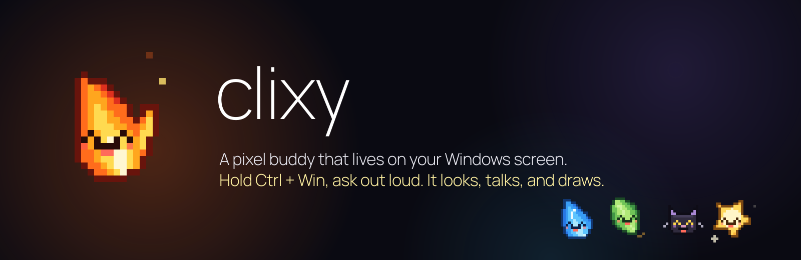
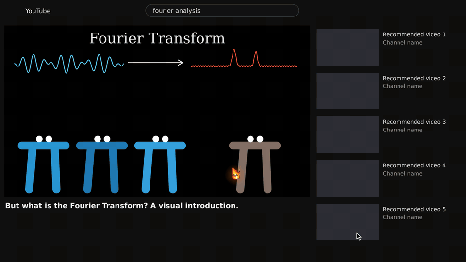
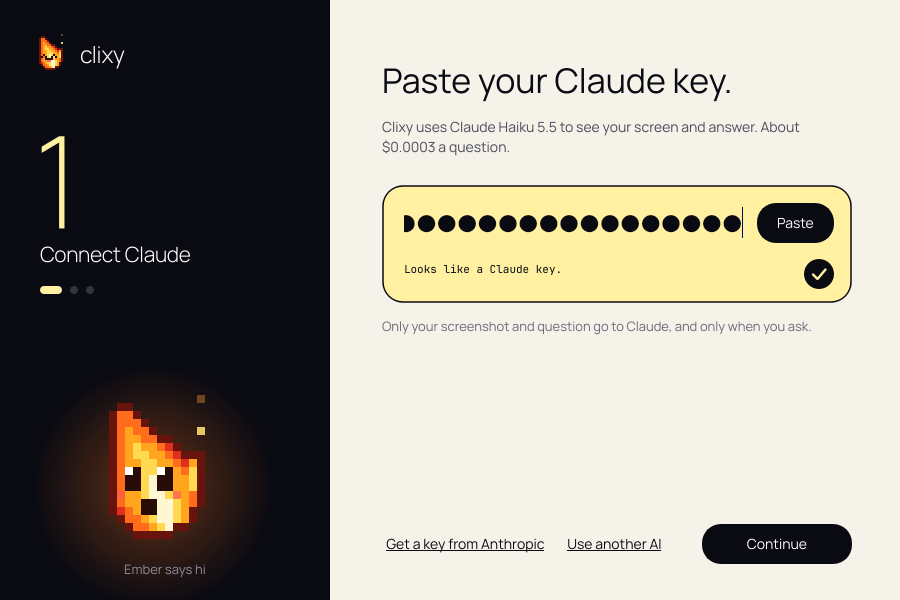
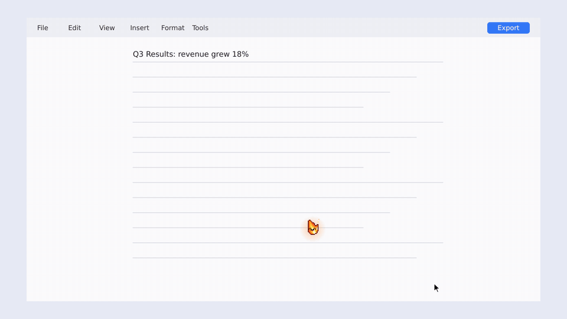
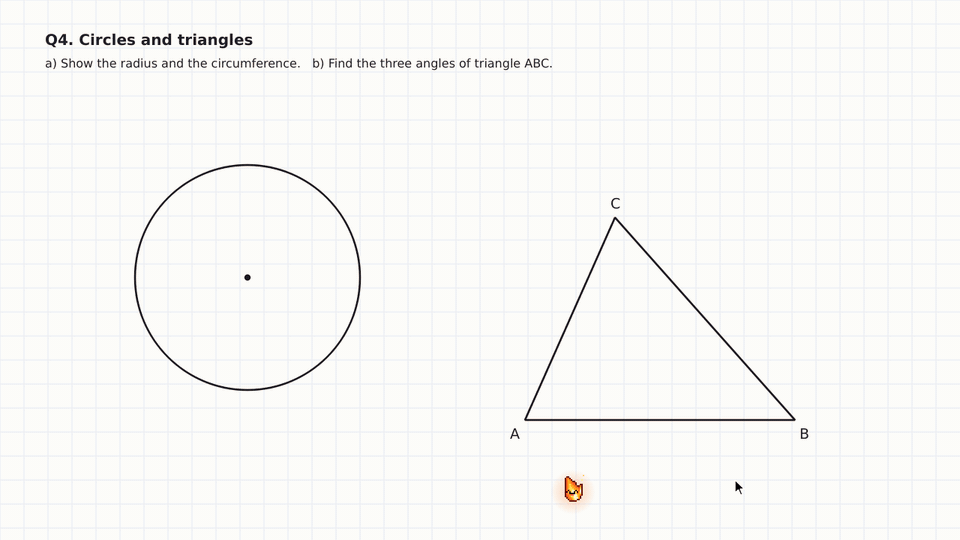
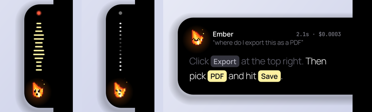
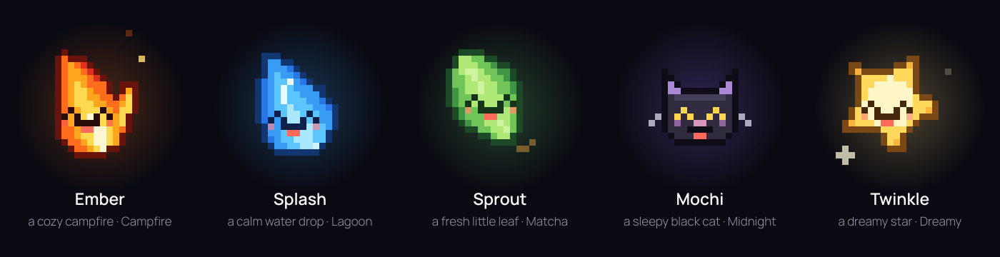
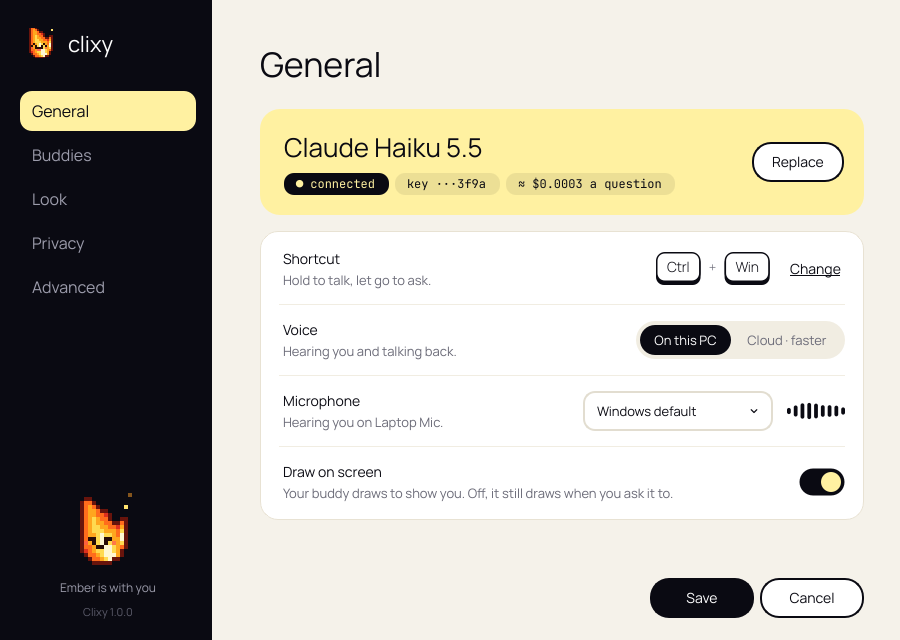
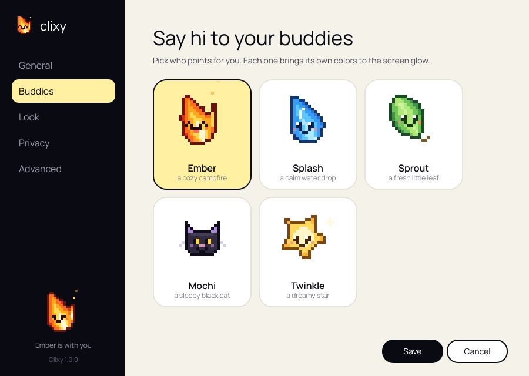

<p align="center">
  
</p>

<p align="center">
  <a href="https://github.com/RaySam07/clixy/releases/latest/download/Clixy-Setup.exe"></a>
</p>

<p align="center">
  <a href="https://github.com/RaySam07/clixy/releases/latest"></a>
  
  
  
  <a href="https://github.com/RaySam07/clixy/stargazers"></a>
</p>

<h3 align="center">Hold <kbd>Ctrl</kbd> + <kbd>Win</kbd>, ask out loud, let go.</h3>
<p align="center">Clixy looks at your screen, talks you through it, and <b>draws</b> exactly where you need to look.<br/>
Stuck in an app, a spreadsheet, a maths problem or a video? Ask your buddy.</p>

<!--
  YOUR VIDEO GOES HERE.
  On github.com, click the pencil to edit this README, then drag your .mp4
  onto the empty line below. GitHub uploads it and pastes a link that plays
  right here in the README. Keep it under 100 MB.
-->

<p align="center">
  
</p>

---

## Get started in a minute

1. **Download** [`Clixy-Setup.exe`](https://github.com/RaySam07/clixy/releases/latest/download/Clixy-Setup.exe) and run it. No admin rights needed.
   Windows may say *"Windows protected your PC"* because Clixy isn't code-signed yet: click **More info → Run anyway**.
2. **Drop in your API key.** Clixy asks for it on first launch: paste it into the box and it checks itself.
   - **Recommended: Claude Haiku 5.5.** Get a key at [console.anthropic.com](https://console.anthropic.com/settings/keys). It's fast, points accurately and costs about **$0.0003 a question**, roughly 250,000 questions per $100.
   - Also works: an OpenRouter key (`sk-or-…`), OpenAI, Google Gemini, or a local model through Ollama (Settings › Advanced).
3. **Say hi to your buddies**, pick one, pick your shortcut, and you're done.

<p align="center">
  
</p>

<details>
<summary><b>Prefer to build it yourself?</b></summary>

Download this repository as a zip, unzip it, and double-click **`Install-Clixy.bat`**. It sets up Python 3.13 (with winget if it's missing), builds `Clixy.exe`, and adds Start menu and desktop shortcuts. Takes about 10 minutes the first time.

Or by hand:

```powershell
py -3.13 -m venv .venv
.venv\Scripts\activate
pip install -r requirements.txt
python app.py
```
</details>

---

## What Clixy does

### It draws where you need to look

Your buddy flies over and draws with its own tip: a snug loop around a button, a box around a chart, a highlighter over a line of text, an arrow from here to there. Several steps get numbers, and each label finds the calmest spot nearby so it never covers what it explains.

<p align="center">
  
</p>

Move your mouse onto a marked thing and that mark says *got it* and fades. The rest fade a few seconds after Clixy stops talking.

### It teaches maths on the figure itself

Ask for the radius and it draws it from the centre to the edge. Ask for the circumference and it traces the circle. Ask for the angles and it marks each one with its size, inside the angle where a teacher would write it.

<p align="center">
  
</p>

### It's precise, not a guess

After answering, Clixy takes a second, closer look at each mark and asks for its exact edges. On Windows it snaps buttons and menus to their real outline. It fits circles to the actual circle in the image and pins radii and corners to it. A mark it can't place confidently isn't drawn at all.

### It lives in a notch on the side of your screen

A black island grows out of the screen edge, like the Dynamic Island turned on its side. It shows a waveform and your buddy while you talk, then your answer as captions with the names of things to click.

<p align="center">
  
</p>

### Five pixel buddies

Ember, Splash, Sprout, Mochi and Twinkle. Each one blinks, reacts and brings its own colours to the glow around your screen while you talk.

<p align="center">
  
</p>

### Settings that make sense

<p align="center">
  
  
</p>

---

## Private and secure by design

| What | Where it goes |
|---|---|
| Your API key | Stays on your PC, encrypted by Windows Credential Manager. Only ever sent to the AI you chose. |
| What you say | Turned into text **on your PC** (faster-whisper). It never leaves the machine unless you choose cloud voice. |
| Clixy's voice | Generated **on your PC** (Kokoro). |
| Screenshot + question | Sent to your AI provider only while you hold the shortcut, to answer you. |
| History | Short notes per app in `~/.clixy/`. Turn it off or wipe it in Settings › Privacy. |
| Telemetry | None. No accounts, no server of ours. |

Found a security issue? See [SECURITY.md](SECURITY.md).

---

## How it works

1. You hold the shortcut. Clixy listens on your PC and captures the screen you're on.
2. Your question and the screenshot go to Claude, which answers out loud and plans marks: a box, a highlight, a radius, an angle.
3. While the answer is spoken, Clixy aims each mark with a zoomed-in second look, fits circles to the image and snaps controls to their real edges.
4. Your buddy flies over and draws them, then waits beside them while you look.

Built with Python and PyQt6. Voice on your PC with faster-whisper and Kokoro. Screen understanding with Claude.

## Troubleshooting

- **Your buddy can't hear you.** Open Settings › General and talk: the **Microphone** row has a live meter and says what's wrong. *Silent* usually means Windows is blocking the mic: click **Open Windows microphone settings** and turn on *Let desktop apps access your microphone*.
- **"Windows protected your PC".** Click **More info → Run anyway**. Code signing is on the roadmap.
- **The shortcut clashes with another app.** Settings › General › Shortcut › **Change**, then hold the keys you want.
- **The first question is slow.** On-device listening downloads its model once (about 150 MB). The notch tells you while it does.

## Roadmap

- [ ] Code-signed installer, so there's no SmartScreen warning
- [ ] More buddies, and a way to draw your own
- [ ] Graphs and charts: mark a point, read a slope
- [ ] Languages beyond English
- [ ] macOS

Ideas and pull requests welcome: see [CONTRIBUTING.md](CONTRIBUTING.md).

---

<p align="center">
  <b>If Clixy helped you, give it a ⭐. It helps more people find their buddy.</b>
</p>

<p align="center">
  <a href="https://star-history.com/#RaySam07/clixy&Date"></a>
</p>

## License

[MIT](LICENSE) © 2026 Rayan Sameer. Clixy builds on earlier open-source work, credited in [THIRD_PARTY_NOTICES.md](THIRD_PARTY_NOTICES.md).
